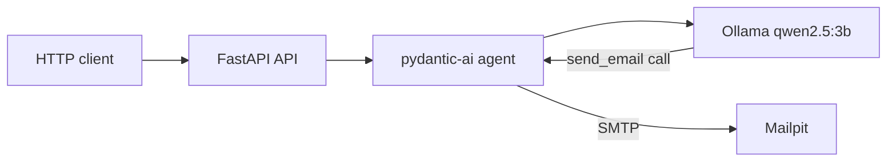

# Message Router

A proof of concept for a microservice that receives a message from an employee, passes it to a local AI agent, and sends an e-mail to the right department. The agent decides on its own by calling the `send_email` tool (function calling). No mail leaves the environment: a local test mailbox catches it.

## Getting started

You need Docker with Compose v2.

```bash
docker compose up -d
```

This command builds the API, starts Ollama and Mailpit, and the API container downloads the `qwen2.5:3b` model weights (about 2 GB) and loads them into memory. The API only starts listening after that. The first run takes a few minutes. Later starts reuse the weights stored in the volume.

Download progress:

```bash
docker compose logs -f api
```

The environment is ready when the `api` service reports `healthy`:

```bash
docker compose ps
```

Stop:

```bash
docker compose down
```

`docker compose down -v` also removes the downloaded model weights.

## Verification

Swagger documentation: [http://localhost:8000/api/v1/docs](http://localhost:8000/api/v1/docs)

Captured messages panel: [http://localhost:8025](http://localhost:8025)

A ticket about a broken computer (expected department: help desk):

```bash
curl -s -X POST http://localhost:8000/api/v1/messages \
  -H 'Content-Type: application/json' \
  -d '{"email":"jan.nowak@example.com","message":"Nie działa mi komputer"}'
```

A leave request (expected department: HR payroll):

```bash
curl -s -X POST http://localhost:8000/api/v1/messages \
  -H 'Content-Type: application/json' \
  -d '{"email":"anna.kowalska@example.com","message":"Chciałbym zgłosić urlop na jutro"}'
```

The response looks like this:

```json
{
  "status": "sent",
  "to": "help-desk@example.com",
  "reply_to": "jan.nowak@example.com",
  "subject": "Nie działa komputer"
}
```

On CPU, a single request usually takes between a dozen and a few dozen seconds. In Mailpit, open the message and check the recipient and the `Reply-To` header: it should equal the `email` field from the request.

## How it works



1. `POST /api/v1/messages` accepts JSON with the `email` and `message` fields.
2. The agent passes the message content and the list of mailboxes to the model served by Ollama.
3. The model calls the `send_email` tool itself. Only that call opens an SMTP connection.
4. The tool sets `Reply-To` to the address from the request and rejects any recipient outside the department list.
5. Mailpit shows the message in its panel on port 8025.

If the model replies with text and does not call the tool, the API retries. After three failed attempts it returns `502`. An empty message fails validation with `422`.

## Design decisions

| Area | Choice | Why |
| --- | --- | --- |
| API | Python 3.12, FastAPI, official `python` image | Swagger comes with the framework, and the docs path is set to `/api/v1/docs`. |
| Agent | `pydantic-ai` and `OllamaModel` | The library handles function calling. The `send_email` tool is the only way to send mail. |
| Model | `qwen2.5:3b` on CPU | The model supports tool calling and Polish, and its weights fit in a few GB of RAM. Context is set to 8192 tokens. |
| Mail | Mailpit (`axllent/mailpit`) | A test mailbox with a web UI. SMTP on `1025`, web UI on `8025`. The image runs on both amd64 and arm64. |
| Reply-To | Set in the tool code | The address comes from the request's `email` field. The model cannot change it. |

Department list the tool enforces:

| Address | Topics |
| --- | --- |
| `help-desk@example.com` | Computer, passwords, e-mail, user applications |
| `it@example.com` | Servers, network, VPN, databases, incidents |
| `kadry@example.com` | Leave, contracts, salaries, sick leave |
| `human-resources@example.com` | Recruitment, onboarding, benefits, team relations |
| `other@example.com` | Anything that does not fit the others |

## Ports and variables

| Service | Address on host |
| --- | --- |
| API | `http://localhost:8000` |
| Swagger | `http://localhost:8000/api/v1/docs` |
| Mailpit | `http://localhost:8025` |
| Mailpit SMTP | `localhost:1025` |
| Ollama | `http://localhost:11434` |

API container variables: `OLLAMA_BASE_URL`, `OLLAMA_HOST_URL`, `OLLAMA_MODEL`, `SMTP_HOST`, `SMTP_PORT`, `SMTP_FROM`. To use a different model with tool support, set `OLLAMA_MODEL` in `docker-compose.yml`. The entrypoint downloads it on the next start.

## Hardware requirements

The Ollama container runs on CPU. Keep about 4 GB of free memory for the 3B model during inference. The image does not reserve a GPU, so the same Compose file starts on machines without an NVIDIA card.
